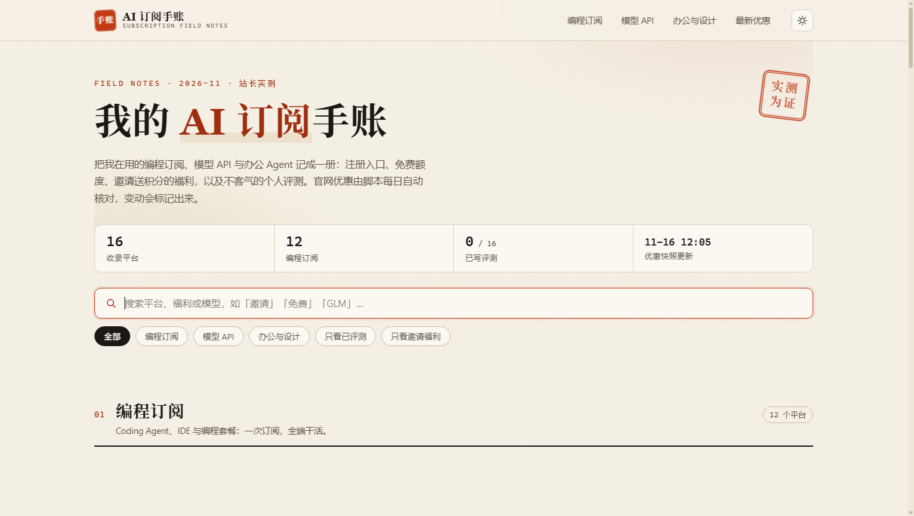

# 我的 AI 订阅手账

个人订阅档案静态站：把站长实际在用的 16 个 AI 编程订阅、模型 API 与办公 / 设计 Agent 记成一册 ——
**注册入口、免费额度、邀请送积分福利、个人评测**，外加一个每日自动从官网核对优惠信息的 GitHub Actions 工作流。

纯静态、零依赖、无构建：`index.html` + `assets/` + `data/` 直接托管 GitHub Pages。

## 预览




## 快速开始

```bash
node scripts/preview.mjs          # 本地预览 http://127.0.0.1:8080（或 python -m http.server）
node scripts/update-promos.mjs    # 手动跑一次官网优惠抓取，生成 data/promos.js
```

- 公开视图：`http://127.0.0.1:8080/`
- 站长模式：`http://127.0.0.1:8080/?edit=1`（写评测、填邀请码、导出配置）

## 上线到 GitHub Pages

1. 在 GitHub 新建 **public** 仓库（例如 `ai-sub-nav`），不要初始化 README。
2. 在本目录推送：

   ```bash
   git init
   git add .
   git commit -m "feat: AI 订阅手账静态站 + 官网优惠自动核对"
   git branch -M main
   git remote add origin https://github.com/<你的用户名>/<仓库名>.git
   git push -u origin main
   ```

3. 仓库 **Settings → Pages → Build and deployment → Source** 选 **Deploy from a branch**，
   分支选 `main`、目录选 `/ (root)`，Save。
4. 约一分钟后访问 `https://<你的用户名>.github.io/<仓库名>/`。
5. 仓库 **Actions** 页可见 `update-promos` 工作流；可点 **Run workflow** 手动触发首跑。
   此后每日 06:00（北京时间）自动抓取官网优惠并提交 `data/promos.js`，Pages 随提交自动重新部署。

两个已知边界：

- GitHub 会在仓库 **60 天无活动**后暂停定时工作流；手动 Run workflow 一次即恢复。
- 工作流跑在 GitHub 海外节点，个别国内官网直连可能失败；失败会**保留上次快照**并在页面「最新优惠」区标记，不会写假数据。

## 填邀请码 / 写个人评测

**方式 A（推荐，不碰代码）**：打开 `?edit=1` → 每张卡片「写评测 / 填邀请码」→
评分、一句话结论、优缺点、正文、使用场景、邀请码、邀请链接 → 保存到草稿 →
顶部「导出 sites.js」→ 用下载的文件覆盖 `data/sites.js` → 提交推送即发布。
草稿只存在当前浏览器 localStorage，**不导出就不会发布**；「恢复已发布版本」可清空草稿。

**方式 B（直接改文件）**：编辑 `data/sites.js` 对应平台：

- `invite.code` / `invite.url`：你的邀请码与邀请链接，填上即显示「复制」按钮与邀请链接；留空自动隐藏。
- `invite.bonus` / `invite.programUrl`：官方公开邀请机制与规则页链接（已预填核实过的部分）。
- `review.rating / verdict / pros / cons / scene / body / updatedAt`：个人评测；全空时卡片显示「评测撰写中」印章态。

## 自动更新机制

| 部件 | 职责 |
| --- | --- |
| `.github/workflows/update-promos.yml` | 每日 06:00 北京时间 + 手动触发；跑脚本、有变化才 commit & push |
| `scripts/update-promos.mjs` | 零依赖抓取 `sites.js` 里各平台 `promoSources` 的公开优惠文案，写 `data/promos.js` |
| `data/promos.js` | 自动快照（生成时间、逐来源状态 / 文案 / 内容哈希），**勿手改** |
| 页面「最新优惠」区 | 展示快照；内容哈希变化标「官网有更新」；失败保留上次快照并列入折叠清单 |

抓取原则：只抓公开营销 / 价格页，每日一次、限流、超时 + 一次重试；动态渲染页（SPA）仅监测可达性与标题变化；
**人工核对字段（`freeTier` / `pricing`）只提示变动、不自动改写**，改口径请人工编辑 `sites.js` 并更新 `checkedAt`。

## 数据口径

- 每个平台卡片右下角标注核对日期；含「实测」标记的字段来自站长账号实测（如免费版每日积分），其余来自官网公开页面，均附来源链接。
- 额度与价格以各官网当前页面为准；本站仅整理公开信息与站长个人体验。
- 邀请码与邀请链接归站长所有；评测只写真实体验，不代笔虚构。

## 目录结构

```
index.html                  页面骨架（含站长编辑对话框）
assets/style.css            纸墨朱砂设计系统（Tokens 单一真源，深 / 浅主题）
assets/app.js               渲染 / 搜索筛选 / 复制 / 主题 / 站长编辑与导出
data/sites.js               人工维护：16 个平台档案（入口 / 额度 / 邀请 / 评测）
data/promos.js              自动生成：官网优惠快照
scripts/update-promos.mjs   抓取脚本（Node >= 18，零依赖）
scripts/preview.mjs         本地静态预览服务器
.github/workflows/…         定时 + 手动工作流
```

## 增加 / 调整平台

在 `data/sites.js` 增删对象即可（字段参照现有条目）：`category` 取 `coding | api | work`；
`promoSources` 决定自动监测哪些官网页；`hue` 决定卡片品牌色相；`monogram` 为字母 / 汉字标记。
无需改任何代码或样式。